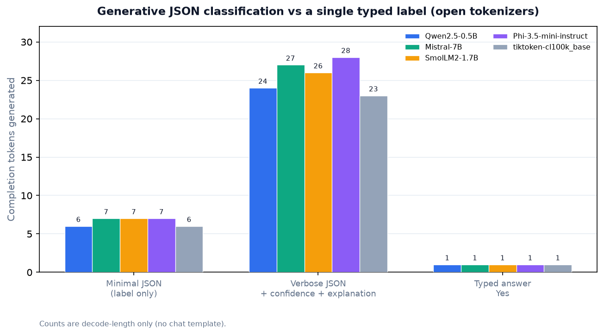
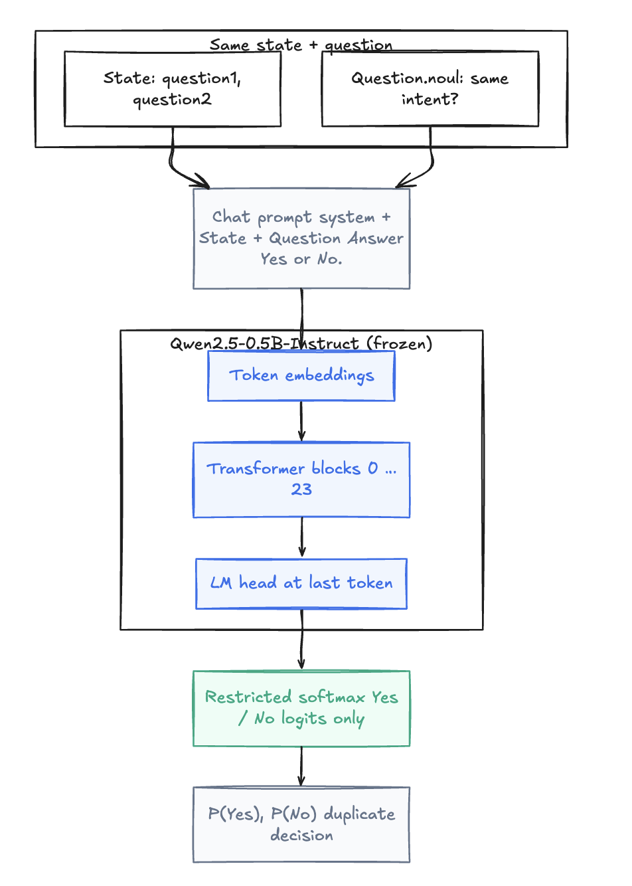
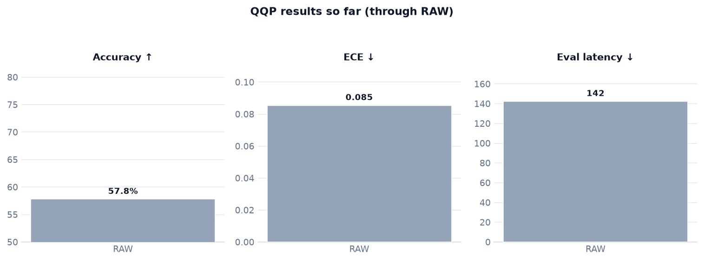
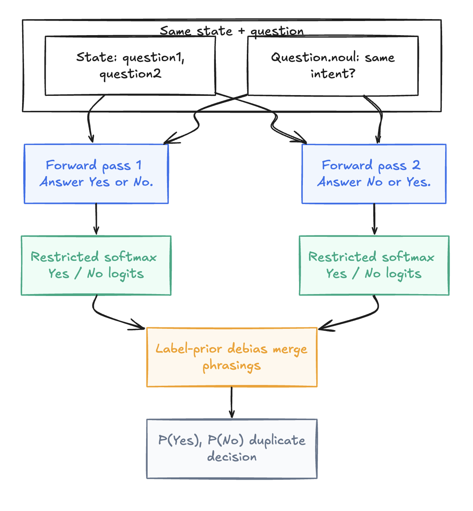
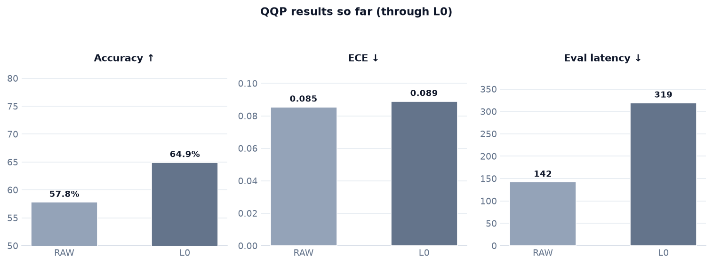
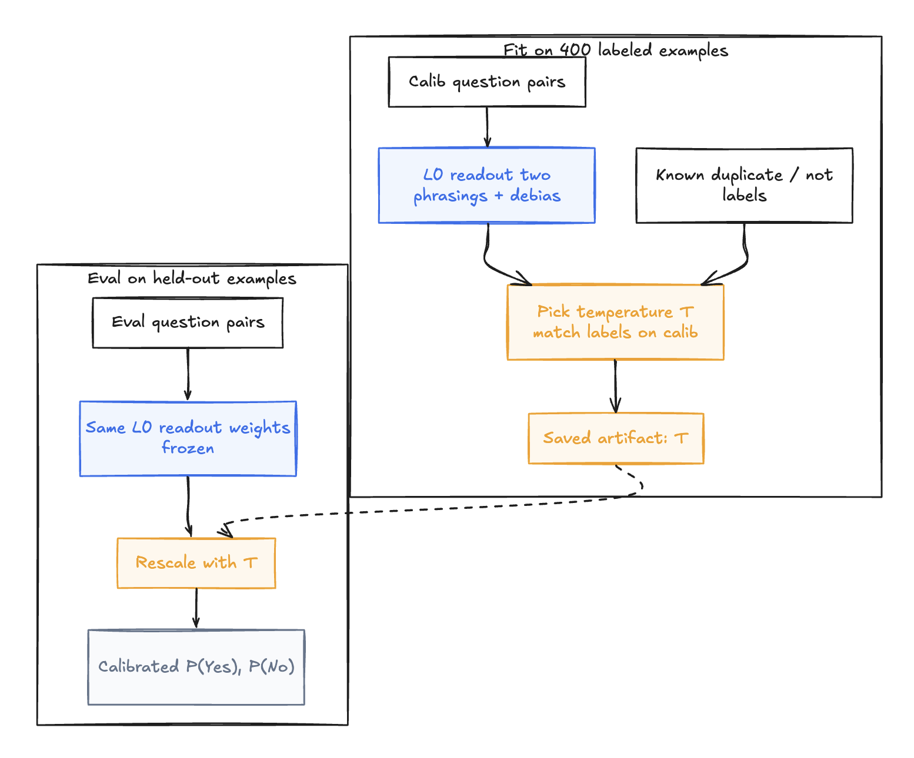
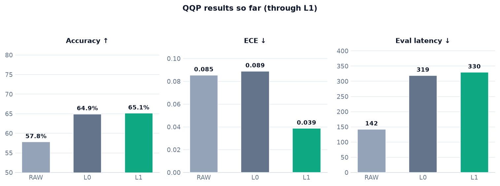
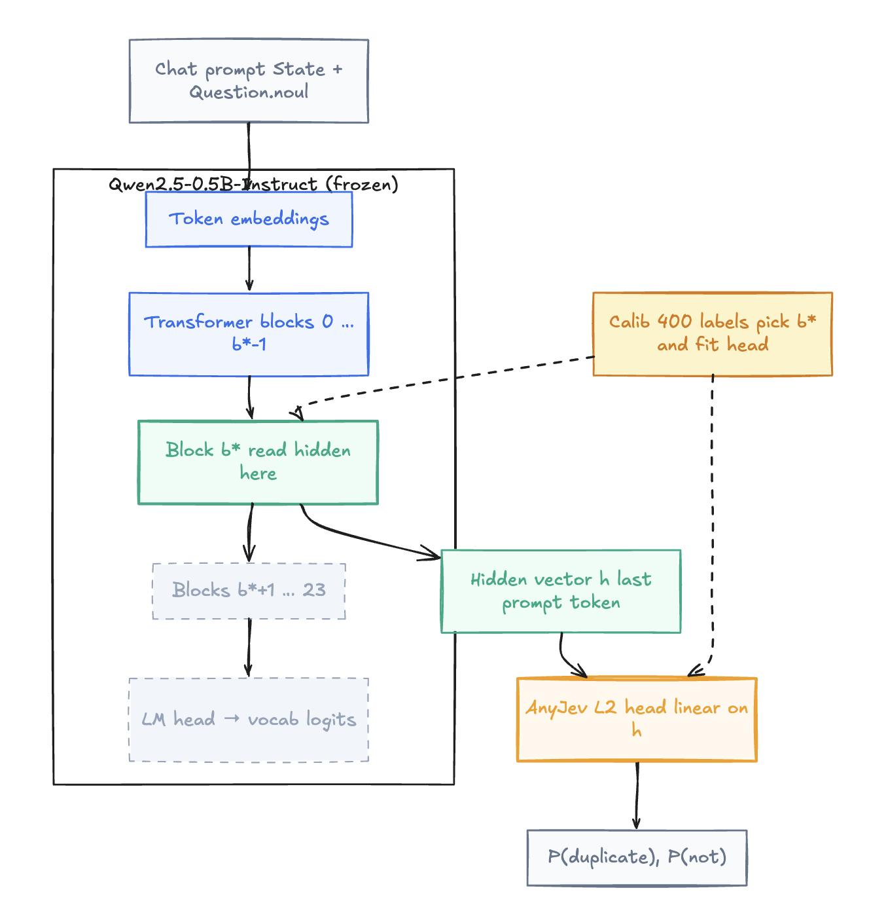
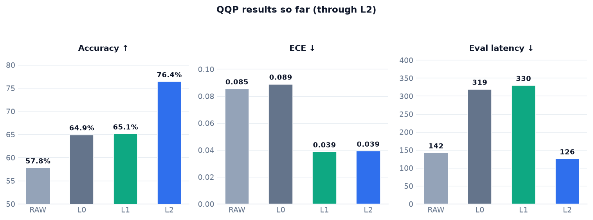

# Transform Any LLM into a Decision Model

*Stop generating labels; read decisions from the model.*

When you use an LLM as a classifier, it can feel like hiring a novelist to fill out a checkbox. You only want a label like `duplicate` or `not_duplicate`, but the model is asked to write something, JSON or a phrase, and your app has to parse it. You pay extra latency and tokens, add brittle parsing, and the “90% confident” from the text rarely means a 90% confidence.

But is that overhead really so bad? I did a quick check across several open tokenizers, counting completion tokens only (decode length, no chat template). For a minimal label object like `{"label": "duplicate"}`, generation is usually about **6–7 tokens**. A little more verbose label object like `{"label": "duplicate", "confidence": 0.92, "explanation": "Same intent."}` is usually ~25 tokens, where as a single **Yes** or **No** is only **one token**. The chart provides a detailed analysis. And btw, a typical prompt instructions that ask for JSON output add about **12–19 input tokens**, depending on wording and tokenizer, for example *“Respond with JSON only…”* vs a longer schema line. While the input token can be processed parallely, output tokens are generated one by one due to autoregression. That means, for verbose json output (you should always get confidence and explanation for production system), it takes on average 27 passes over the LLM. I hope that clarrifies why I am saying it's a lot!

<figure markdown> 
    
    <figcaption>Bar chart of completion tokens for minimal JSON, verbose JSON, and a single “Yes” across five tokenizers.</figcaption>
</figure>

Don’t get me wrong: LLMs can be excellent at classification. But using a generative model for a small, structured decision is too much imo. So, what if we could keep the LLM’s understanding while giving it a cleaner way to make decisions? [AnyJev](https://github.com/nokia-applied-research/AnyJev) does exactly that, and offers a progression of approaches based on your use case and whether you have labeled examples available. They are:

- **Raw:** run one pass over the model and turn the answer-token logits into label ranking.
- **L0:** reduce answer-order and label bias.
- **L1:** use labeled examples to make L0’s confidence more trustworthy.
- **L2:** use labeled examples to fit a small classifier on the model’s hidden representation.

We’ll work through the levels on one dataset, with the code and results at each stage. By the end, you’ll know how to transform any LLM into a decision model using AnyJev, along with what happens behind the scene. Let's go!

## The experiment

We’ll use [Quora Question Pairs (QQP)](https://huggingface.co/datasets/nyu-mll/glue/viewer/qqp/validation). Each example contains two questions; the decision is whether they ask the same thing, i.e., whether they are duplicates or not. 

The experiment uses a balanced set of 1,500 validation examples, with 750 duplicates and 750 non-duplicates. Another 400, disjoint examples are used for later steps (to calibrate L1 and fit L2). We use the same held-out examples to score each level. To keep things easy, I will be using `Qwen/Qwen2.5-0.5B-Instruct` model.

We’ll track accuracy, expected calibration error (ECE), and evaluation time per example. Accuracy measures how often the most likely class is correct. ECE measures how closely confidence matches observed accuracy across confidence groups; lower is better. Latency here is measured on a simple CPU setup.

## Attempt one: Raw scores

We start simple: treat the LLM as a **scorer**, not a writer. For each question pair we ask a single yes/no and read how strongly the model would say **Yes** versus **No** at the answer position. Raw is the baseline for everything that follows. 

To begin with, we need to define the state (i.e. the two queries we want to compare) and the question (i.e. defining the ask of this classification task, which is are these queries duplicate or not). Behind the scene, the state and question are transformed into a chat prompt (system line, `State:` block, `Question:` block, then `Answer Yes or No.`). The model runs **one forward pass** through the full transformer. At the end, we read logits only for the single-token ids of **Yes** and **No**, apply softmax, and returns `[P(Yes), P(No)]`. Nothing is decoded token by token. 

<figure markdown> 
    
    <figcaption>One chat prompt, full forward pass, restricted Yes/No logits at the answer token, P(duplicate).</figcaption>
</figure>

Now let's code it up with AnyJev. Define the QQP decision as a `noul` question and a state dict. `noul` is AnyJev’s yes/no type: **Yes** means duplicate, **No** means not duplicate. 

```python
from anyjev import Question

is_duplicate = Question.noul(
    "Do question1 and question2 ask the same thing?",
    name="is_duplicate",
)

state = {
    "question1": "How do I reset my password?",
    "question2": "What is the process to change my password?",
}
```

Load the model and a `Decider`. The backend runs the transformer; the `Decider` builds prompts, calls the backend, and returns a structured `Decision` (level, probs, diagnostics).

```python
from anyjev import Decider
from anyjev.backends.hf import HFBackend

backend = HFBackend(
    "Qwen/Qwen2.5-0.5B-Instruct",
    device="cpu",
    dtype="float32",
)
decider = Decider(backend, level="raw")

raw = decider.decide_batch([state], is_duplicate, level="raw")[0]
print(raw.level, raw.probs)

# Illustrative output format:
# raw [0.74, 0.26]
#       ↑     ↑
#    P(Yes) P(No)
```

On our password example, if Raw favors `Yes`, the pair is classified as duplicate.

On the 1,500-example QQP eval, we got **57.8% accuracy**, **0.085 ECE**, **~142 ms** per example. Raw is fast here because it uses one phrasing and one forward pass per example, but the accuracy is not much better than a coin toss. Only if we could do more. 


| Level | What it reads              | Labeled examples Used | Accuracy | ECE ↓ | Latency / example |
| ----- | -------------------------- | --------------------- | -------- | ----- | ----------------- |
| Raw   | Direct answer-token scores | 0                     | 57.8%    | 0.085 | 142 ms            |


<figure markdown> 
    
    <figcaption>QQP benchmark metrics for the Raw level only—accuracy, ECE, and eval latency on 1,500 pairs.</figcaption>
</figure>

## Attempt two: L0 - Order matters

Do you trust your model to be unbiased? You shouldn't. Simple things like flipping the order of class in prompt to `No or Yes` instead of `Yes or No` can flip the winner. **L0** is AnyJev’s fix for that.

Behind the scene, for this binary `noul` question, AnyJev L0 runs **two full runs** per example, the same state and question, but once with `Answer Yes or No.` and once with `Answer No or Yes.` At each answer slot it reads **Yes** / **No** logits only, maps both phrasings back to the same semantic classes, and **merges** the two distributions (by default, a geometric mean in probability space). It also estimates a **label prior** from inputs and divides that out before merging.

<figure markdown> 
    
    <figcaption>Two forward passes for “Yes or No” vs “No or Yes”, restricted Yes/No logits, prior debias, and merged P(duplicate).</figcaption>
</figure>

The API change is small: set the default level to L0 and you are done. 

```python
decider = Decider(backend, level="L0")
decisions = decider.decide_batch(eval_states, is_duplicate, level="L0")
```

On the same 1,500-example eval we get **64.9% accuracy**, **0.089 ECE**, and **~319 ms** per example. And as suspected, model was really biased and a simple smart double run gave accuracy 7% jumps over Raw. Two problems here, the latency just 2x and the ECE is still not something to boast about. 


| Level | What it reads                | Labeled examples | Accuracy | ECE ↓ | Latency / example |
| ----- | ---------------------------- | ---------------- | -------- | ----- | ----------------- |
| Raw   | Direct answer-token scores   | 0                | 57.8%    | 0.085 | 142 ms            |
| L0    | Debiased answer-token scores | 0*               | 64.9%    | 0.089 | 319 ms            |


<figure markdown> 
    
    <figcaption>Cumulative QQP results through Raw and L0 on accuracy, ECE, and latency.</figcaption>
</figure>

## Attempt three: L1 calibrates confidence

L0 improved **accuracy**, but scores can still be overconfident or underconfident when you want to automate or cap risk. **L1** keeps the exact same L0 approach in the model and learns one scalar **temperature** `T` from the 400 labeled calibration examples. The point is to make **confidence match reality** (lower ECE) while accuracy stays almost flat.

During fit, AnyJev scores every calibration row at **L0** (both phrasings, same prior correction as above), then picks `T` so softened or sharpened probabilities align better with the known duplicate / not-duplicate labels. At eval time the LLM still does those L0 forward passes; the saved artifact only rescales the returned probs. The transformer weights remain unchanged.

<figure markdown> 
    
    <figcaption>Fit temperature T on L0 scores from labeled calib rows; at eval, same L0 readout then rescale with stored T.</figcaption>
</figure>

Let's code and test,

```python
# calibration
l1_artifact = decider.calibrate(
    is_duplicate,
    calib_states,
    calib_labels,
    level="L1",
)

# loading artifact
decider.load_artifact(is_duplicate, l1_artifact)

# run
l1_decisions = decider.decide_batch(
    eval_states,
    is_duplicate,
    level="L1",
)
```

On eval we see **65.1% accuracy**, **0.039 ECE**, and **~330 ms** per example. Accuracy is nearly unchanged from L0; ECE falls from **0.089 → 0.039**. That is what good calibration looks like: more trustworthy scores.


| Level | What it reads                   | Labeled examples | Accuracy | ECE ↓ | Latency / example |
| ----- | ------------------------------- | ---------------- | -------- | ----- | ----------------- |
| Raw   | Direct answer-token scores      | 0                | 57.8%    | 0.085 | 142 ms            |
| L0    | Debiased answer-token scores    | 0*               | 64.9%    | 0.089 | 319 ms            |
| L1    | L0 scores + temperature scaling | 400              | 65.1%    | 0.039 | 330 ms            |


<figure markdown> 
    
    <figcaption>Cumulative QQP results through Raw, L0, and L1 after temperature calibration.</figcaption>
</figure>

If labels can fix confidence, they might also help learn a **better boundary**? That's next! 

## Attempt four: L2 uses a hidden representation

So far we only asked what the LM head would emit at the last token. For duplicate detection, a **mid-layer hidden state** may already separate “same intent” from “different” more cleanly than **Yes** vs **No** logits. **L2** uses the same 400 labeled examples to fit a small **linear head** on hidden vectors from a chosen transformer block. At inference we can **stop the forward pass early** at that block, skipping full depth and answer-token scoring, and still get a probability for each class.

On the calibration set, AnyJev runs prompts forward, records hiddens at candidate **blocks**, and fits a lightweight head with cross-validation on those rows. The LLM is not fine-tuned; only the head is stored for this question. At eval, the backend runs **partial depth** until the selected block, applies the head to the hidden vector, and returns class probabilities.

<figure markdown> 
    
    <figcaption>Qwen2.5-0.5B stack with early exit at block b*; AnyJev linear head on hidden h at the answer token instead of the LM head.</figcaption>
</figure>

Fit on the calib split, load the artifact, and batch at L2:

```python
# train head
l2_artifact = decider.fit_head(
    is_duplicate,
    calib_states,
    calib_labels,
)

# load
decider.load_artifact(is_duplicate, l2_artifact)

# run
l2_decisions = decider.decide_batch(
    eval_states,
    is_duplicate,
    level="L2",
)
```

The eval numbers are **76.4% accuracy**, **0.039 ECE**, and **~126 ms** per example - about **+11.5 points** over L0 on accuracy and roughly **2.5× faster** than L0 on this CPU run. ECE stays in the same band as L1.


| Level | What it reads                   | Labeled examples | Accuracy  | ECE ↓     | Latency / example |
| ----- | ------------------------------- | ---------------- | --------- | --------- | ----------------- |
| Raw   | Direct answer-token scores      | 0                | 57.8%     | 0.085     | 142 ms            |
| L0    | Debiased answer-token scores    | 0*               | 64.9%     | 0.089     | 319 ms            |
| L1    | L0 scores + temperature scaling | 400              | 65.1%     | 0.039     | 330 ms            |
| L2    | Hidden state + fitted head      | 400              | **76.4%** | **0.039** | **126 ms**        |


<figure markdown> 
    
    <figcaption>QQP results after L2 (full progression)</figcaption>
</figure>

## Conclusion

AnyJev turns a frozen LLM into a decision model in steps: Raw exposes biased token scores; L0 debiases; L1 calibrates confidence; L2 fits a small head on a hidden state and delivered the big accuracy and latency win on QQP. While they might seem like a progression, you can jump across the steps or only use the one that solves your problem. But I hope this article highlights why using LLM directly for classification tasks is not the "best" way to do things. 

Till next time! :wave: 