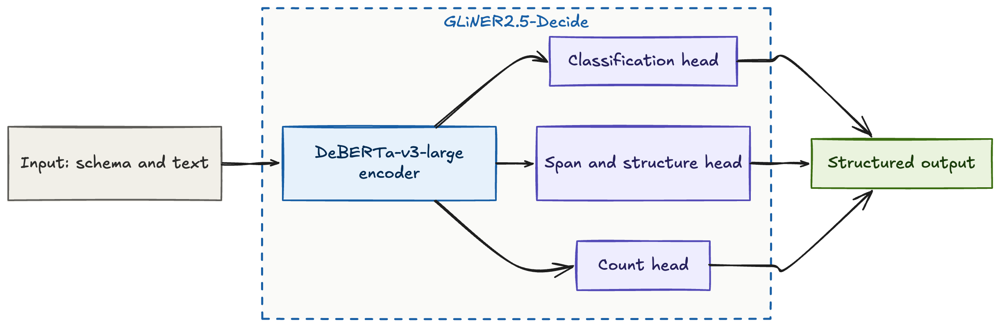
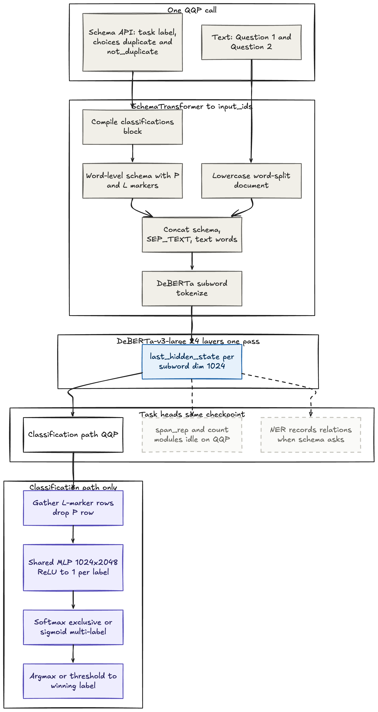

GLiNER2.5-Decide
================

## Introduction

- [**GLiNER2.5-Decide**](https://huggingface.co/fastino/GLiNER2.5-Decide) is Fastino’s **open-weight** decision model in the GLiNER2 family: one **DeBERTa-v3-large** encoder (~435M parameters total) with **schema-conditioned** heads for classification, NER, structured records, relations, and constrained multi-field routing.
- It is **not** a decoder LLM. Inference **scores** label candidates encoded in the input sequence, with no token-by-token generation.
- Python SDK: [GLiNER2](https://github.com/fastino-ai/GLiNER2) (`AutoExtractor`, `classify_text`, `batch_classify_text`). Docs: [Fastino GLiNER-2.5-Decide](https://docs.fastino.ai/concepts/gliner-2-5-decide) | [Paper](https://arxiv.org/abs/2507.18546).
- For a hosted System One API with similar use cases, see [Jev](jev.md). For QQP benchmarks and LoRA fine-tuning that closes the accuracy gap with Jev, see the [blog post](gliner2_5_decide_qqp_blog.md).

## Architecture overview

GLiNER2.5-Decide is a **single encoder, multiple heads** design. A **DeBERTa-v3-large** stack reads one joint sequence built from your **document text** and a **task schema** (field names, label options, span types, and relations). The encoder does not emit open-ended text; it produces contextual vectors for every token, and **task-specific heads** read out structured predictions at schema marker positions.

- **Schema in the sequence:** The SDK serializes the task into special tokens (for example `[P]` for a property or task slot, `[L]` for a discrete label option, and separators such as `[SEP_TEXT]` before the raw text). Because the label vocabulary lives in the input, there is no fixed `num_labels=N` linear layer tied to one training setup. You define **new fields and label strings at inference time** as long as they fit the model’s token budget.
- **Shared backbone, routed heads:** The same weights support **classification**, **NER / span extraction**, **structured records**, **relations**, and richer **multi-field** schemas. Each mode uses the encoder output at the indices the preprocessor recorded for that schema shape.
- **Structured answers only:** The model chooses from the **labels and fields you put in the schema**. It does not generate open-ended text like a chat LLM.

<figure markdown> 
    
    <figcaption>End-to-end flow: text plus schema in, structured scores out</figcaption>
</figure>

### Classification example

The most common entry point is `classify_text`: you pass a string (or batch) and a **task map** from field names to **lists of label strings**. The library turns that into a schema prefix, appends your text, runs the encoder, and applies the **classification head**.

1. **Tokenize** the combined schema + text with the DeBERTa tokenizer.
2. **Encode** the full sequence; each subword gets a hidden state (1024-d for DeBERTa-v3-large).
3. **Gather** hidden states at each `[L]` token (one row per candidate label for that field).
4. **Score** each row with a shared MLP (`hidden → 2×hidden → 1` logit per label).
5. **Decide** with **softmax** over logits when labels are mutually exclusive, or other losses during training for multi-label fields.

Duplicate detection on question pairs is a minimal two-label task. The schema prefix might look like:

```text
( [P] label ( [L] duplicate [L] not_duplicate ) ) [SEP_TEXT] question 1 : … question 2 : …
```

The winning label is **argmax** over the two logits at the `[L]` positions (optionally returned with confidence via `include_confidence=True`).

<figure markdown> 
    
    <figcaption>Classification pass: tokenization, encoder, and label-row scoring</figcaption>
</figure>

## Code example

```python linenums="1"
from gliner2 import AutoExtractor

model = AutoExtractor.from_pretrained("fastino/GLiNER2.5-Decide")
model.eval()

text = (
    "Question 1: How do I reset my password?\n"
    "Question 2: What is the process to change my password?"
)

response = model.classify_text(
    text=text,
    tasks={"label": ["duplicate", "not_duplicate"]},
)
# {"label": "duplicate"}
# With include_confidence=True:
# {"label": {"label": "duplicate", "confidence": 0.77}}
```

Batch inference: `batch_classify_text` with the same task schema.

## Comparison with BERT and Jev

| | BERT pair classifier | Jev | GLiNER2.5-Decide |
|--|----------------------|-----|------------------|
| Deployment | Local | Hosted API | Local (open weights) |
| Labels | Fixed head | NL criteria in request | Schema strings in-sequence |
| Output | Fixed logits | Typed + calibrated | Finite schema candidates |
| Generation | No | No | No |
| Zero-shot new tasks | Weak | Strong (API) | Built for new schemas |
| Internals public | Yes | No | Yes |

## Fine-tuning

- Use `gliner2.training.ExtractorTrainer` with `InputExample` + `Classification` targets; **LoRA** on the encoder is the lightweight default (adapter-only checkpoints).
- Separate learning rates for **encoder** and **task heads** are typical. Training still builds **text + schema** batches; loss is classification BCE / softmax on label logits.
- For a single two-label task (such as QQP), training and inference are just **softmax over those two logits**. Larger multi-field schemas use the same text-plus-schema setup with more fields.

Details and QQP numbers: [GLiNER2.5-Decide QQP fine-tuning blog](gliner2_5_decide_qqp_blog.md).

## References

[1] GLiNER2.5-Decide: [Hugging Face](https://huggingface.co/fastino/GLiNER2.5-Decide) | [Fastino docs](https://docs.fastino.ai/concepts/gliner-2-5-decide) | [GLiNER2 repo](https://github.com/fastino-ai/GLiNER2)

[2] GLiNER2 paper: [arXiv:2507.18546](https://arxiv.org/abs/2507.18546)

[3] System One API counterpart: [Jev](jev.md)
