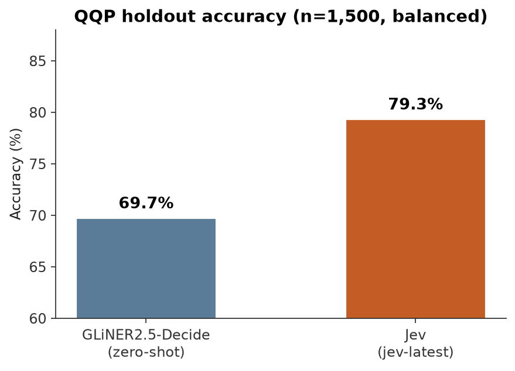
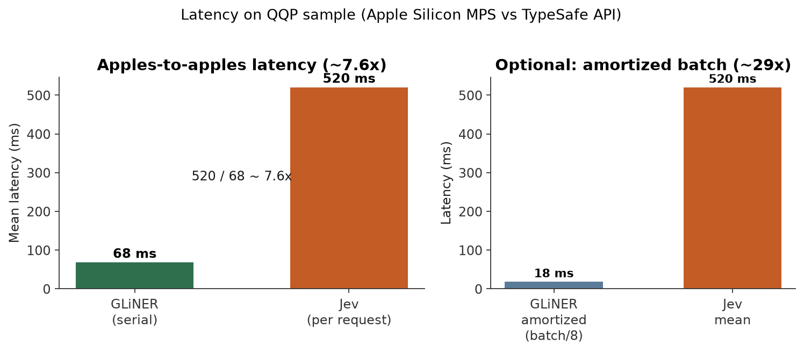
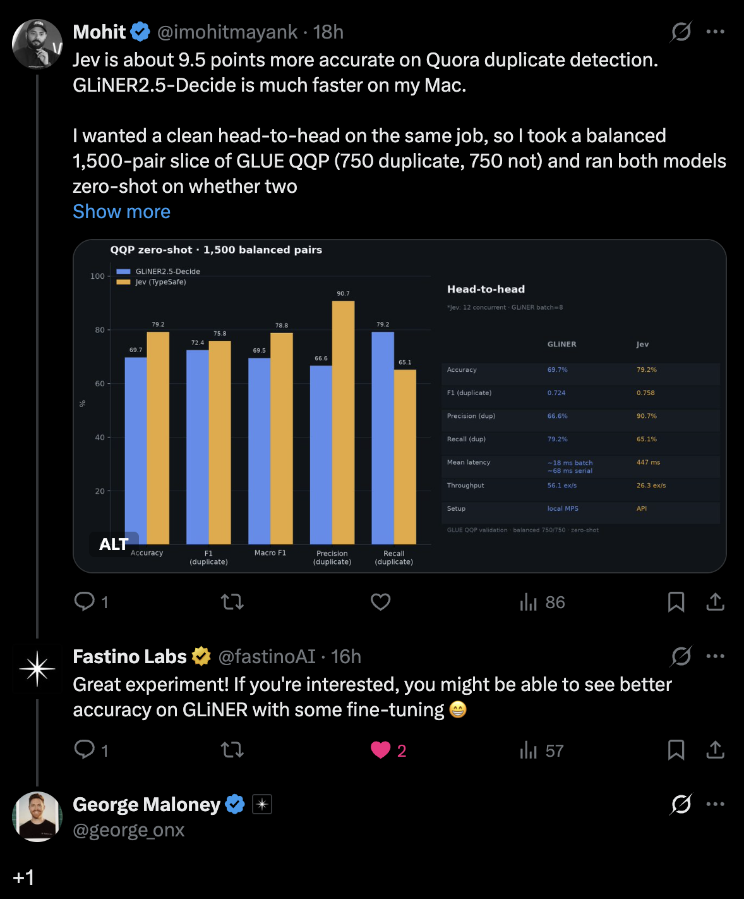
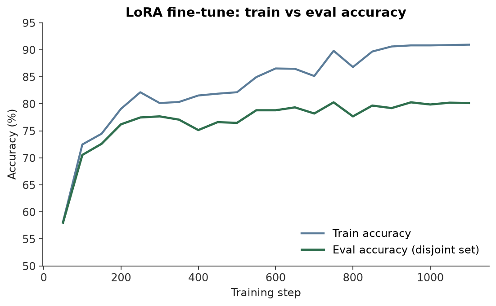
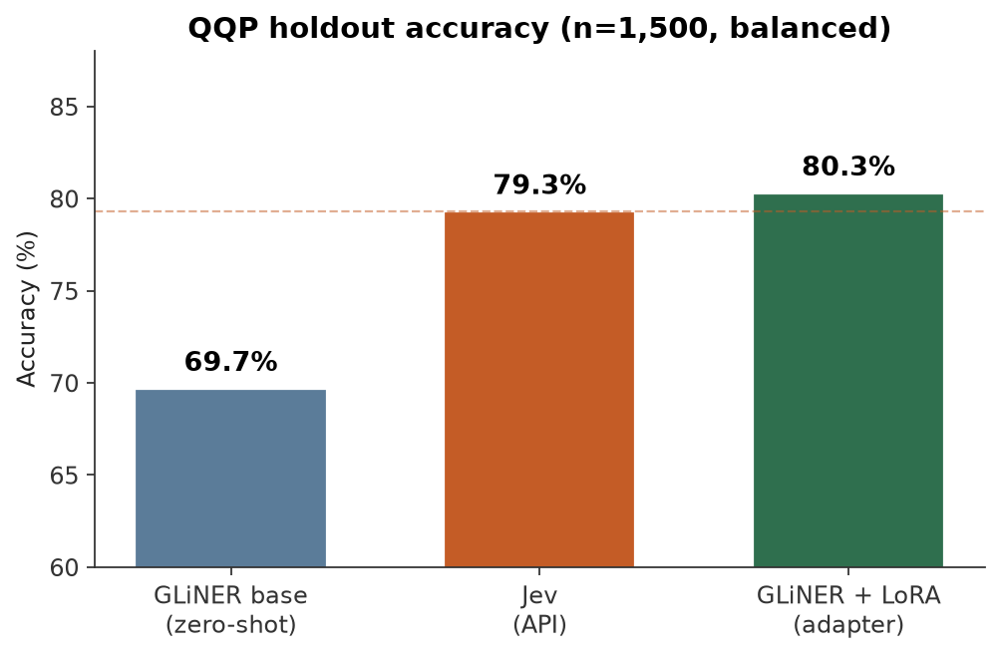
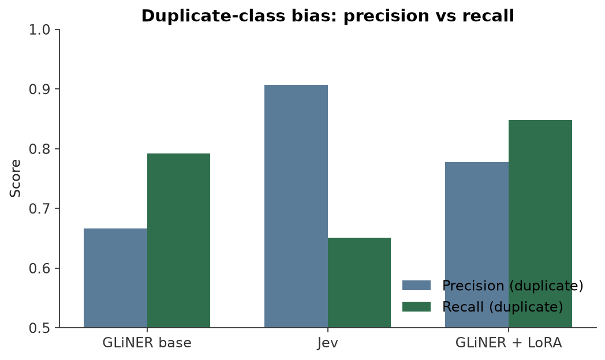
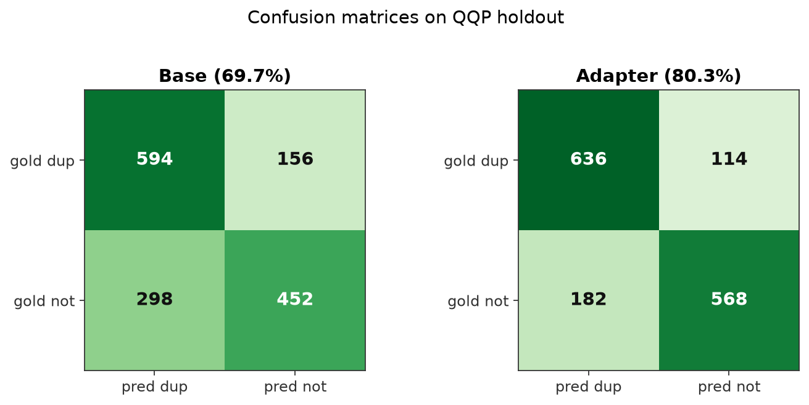

GLiNER2.5-Decide fine-tuned: Local System One model, Jev-level accuracy, ~7× faster
====================================================================================

Hands-on guide to [Jev](jev.md) and open-source [GLiNER2.5-Decide](gliner2_5_decide.md) System One models, their architecture, and how to fine-tune one for better accuracy and lower latency on your machine.

## 1. Introduction

Large language models are everywhere, and they are used for almost everything: from deciding whether text is a duplicate to solving [million-dollar math problems](https://openai.com/index/navier-stokes-solution/).

The catch is that many tasks don't need a full LLM. Asking a chat model whether two questions are duplicates, or whether a ticket is urgent, is like bringing a bazooka to a gunfight: you pay for tokens you do not need, wait on token-by-token generation, and still have to scrape free text that can invent structure or wander off-schema. A short, typed answer would have been enough.

The shift came when [**TypeSafe** shipped **Jev**](https://typesafe.ai/blog/introducing-system-one-models-and-jev): a “System One” model (referring to [Kahneman’s "Thinking, Fast and Slow"](https://en.wikipedia.org/wiki/Thinking,_Fast_and_Slow)) that returns **typed, calibrated answers** instead of essays. With this, you get near-LLM performance with classical-ML latency: best of both worlds. But Jev runs behind an API, and while the model itself is quick, you still pay network latency on every call, and the weights are closed. For anything that has to stay in-house (privacy, cost, control), that is real friction. You want the same type of model, but something that runs locally.

So I fine-tuned an open decision model ([GLiNER2.5-Decide](gliner2_5_decide.md)) for duplicate detection and got **Jev-level accuracy** with **~7–8× faster** serial inference than the API, fully on-device. The rest of this piece is how I got there.

---

## 2. Jev 101

If you are okay with a closed-source API, you can simply use Jev directly. Here’s the gist: [Jev](https://www.jevtypesafeai.com/) is TypeSafe’s System One model. You provide a **state** (all the facts needed for the decision) and a set of **questions**, and the API returns **typed answers** that are ready to use, not prose you have to parse. There are three question types: `choice`, `score`, and `noul` (a yes/no expressed as a calibrated probability). For more details, see [TypeSafe’s introduction](https://typesafe.ai/blog/introducing-system-one-models-and-jev) or the [Jev model page](jev.md).

Here is the smallest useful call, a single **noul**:

```python linenums="1"
# Using the TypeSafe SDK for Python
from typesafe_sdk import Noul, TypeSafeClient

# Initialize the TypeSafe client
client = TypeSafeClient()

# Make the system one call
response = client.system_one(
    state={
        "question1": "How do I reset my password?",
        "question2": "What is the process to change my password?",
    },
    questions={
        "is_duplicate": Noul(
            instructions="Do question1 and question2 ask the same thing?",
        ),
    },
)

# Print the result
print(response.answers["is_duplicate"].noul)
# Example response:
# {
#   "model": "jev-1.13.0",
#   "usage": {
#     "input_tokens": 308,
#     "output_tokens": 21
#   },
#   "answers": {
#     "is_duplicate": {
#       "type": "noul",
#       "noul": 0.71
#     }
#   }
# }
# Note: 0.71 → treat as yes if >= 0.5
```

And that's it: you pass in a state, receive a probability, and can directly hook that into business logic without any complex parsing. Jev is now open to all (no more waitlist), and new signups get $5 in free credits; that's enough for about 119 million tokens at today’s rates (only input tokens are billed, not output).

---

## 3. Going local: GLiNER2.5-Decide

If you are **not** okay with a closed-source API because of privacy, cost at volume, or the need to beat a zero-shot model on your own data, you need something local. After Jev shipped, I looked at similar open-source releases and picked [Fastino’s](https://x.com/fastinoAI) **GLiNER2.5-Decide** because its weights are on [Hugging Face](https://huggingface.co/fastino/GLiNER2.5-Decide), it has a schema-driven [Python SDK](https://github.com/fastino-ai/GLiNER2) (`classify_text` / `batch_classify_text`), and inference supports Apple Silicon MPS.

**What it is.** Decide is not an LLM. It is a DeBERTa-v3-large encoder (overall ~435M parameters = ~340M in the transformer stack + ~95M embedding table). One model that can be used for classification, NER, structured records, and relations because it provides multiple heads (one for each task) on the same weights.

<figure markdown> 
    
    <figcaption>GLiNER2.5-Decide architecture overview</figcaption>
</figure>

GLiNER2.5-Decide shares one DeBERTa-v3-large encoder across multiple task-specific heads. For this post, we will explore a model that can identify whether two questions are the same or not, i.e., duplicate detection. This task can be translated into a classification problem with two labels: `duplicate` and `not_duplicate`. Let's run the model on one example.

Suppose I have the following input:

```json
{
    "question1": "How do I reset my password?",
    "question2": "What is the process to change my password?"
}
```

To run the model, I can use the `classify_text` module as follows:

```python linenums="1"
# Import the GLiNER2.5-Decide package
from gliner2 import AutoExtractor

# Load the model (same entry point as scripts/qqp_benchmark.py)
model = AutoExtractor.from_pretrained("fastino/GLiNER2.5-Decide")
model.eval()

# Define a function to format the question pair
def format_question_pair(question1: str, question2: str) -> str:
    return f"Question 1: {question1}\nQuestion 2: {question2}"

# Format the question pair
text = format_question_pair(
    "How do I reset my password?",
    "What is the process to change my password?",
)

# Classify the questions
response = model.classify_text(
    text=text,
    tasks={"label": ["duplicate", "not_duplicate"]},
)
print(response)
# Default: task name -> winning label string
# {"label": "duplicate"}
#
# Optional: include_confidence=True
# {"label": {"label": "duplicate", "confidence": 0.77}}
```

Cool, it works! But how does it work under the hood? Let's see.

First, the input is formatted into a single string with the following schema:

```text
( [P] label ( [L] duplicate [L] not_duplicate ) ) [SEP_TEXT] question 1 : … question 2 : …
```

Then, the string is tokenized into subwords using the DeBERTa tokenizer. The subwords are then passed to the DeBERTa encoder. The encoder returns one 1024-dimensional vector per subword. During preprocessing, the library records marker positions (subword indices for `[P]` and each `[L]`). At score time, it gathers only the `[L]` rows into a `[n_labels, 1024]` tensor. A shared MLP (`1024 → 2048`, ReLU, `2048 → 1`) is applied to each label row independently (batched as one matrix multiplication), yielding one logit per label. For exclusive tasks like duplicate detection, softmax over those logits gives probabilities; argmax picks `duplicate` or `not_duplicate`.

A more detailed flow diagram is as follows:

<figure markdown> 
    
    <figcaption>One classification pass through GLiNER2.5-Decide</figcaption>
</figure>

To close it off, let's compare GLiNER2.5-Decide against classical BERT and Jev.

| | BERT | Jev | GLiNER2.5-Decide |
|--|-------------------|-----|------------------|
| Deployment | Local | Hosted API | Local (open weights) |
| Labels | Fixed head | NL criteria in request | Schema strings in-sequence |
| Output | Fixed logits | Typed + calibrated | Finite schema candidates |
| Generation | No | No (decisions) | No |
| Zero-shot new tasks | Weak | Strong (API) | Built for new schemas |
| Internals public | Yes | No | Yes |

---

## 4. Zero-shot run on GLiNER2.5-Decide and Jev

To test out the model, I used the [GLUE QQP](https://huggingface.co/datasets/glue/viewer/qqp/train) dataset. The dataset is a collection of pairs of Quora questions and a column that indicates if the questions are duplicates. The evaluation set is a balanced stratified sample of **1,500** pairs (750 duplicate / 750 not_duplicate), `random_state=42` selected from the validation set. The inference for Jev is as mentioned above; for GLiNER2.5-Decide, I used the `batch_classify_text` module with a batch size of 8. The results are as follows:

### Accuracy

| Model | Accuracy | F1 (duplicate) | Macro F1 |
|-------|----------|----------------|----------|
| GLiNER2.5-Decide (zero-shot) | 69.7% | 0.724 | 0.695 |
| Jev (`jev-latest`) | 79.3% | 0.759 | 0.788 |

<figure markdown> 
    
    <figcaption>Zero-shot accuracy: GLiNER2.5-Decide vs Jev</figcaption>
</figure>

Zero-shot on 1,500 balanced GLUE QQP pairs: Decide at 69.7% accuracy, trailing Jev's 79.3% by roughly a 10-point gap.

### Latency

| Measurement | GLiNER | Jev | Ratio |
|-------------|--------|-----|-------|
| **Serial mean (headline)** | **~68 ms** | **520.1 ms** | **~7.6×** |
| Amortized batch mean (`batch_size=8`) | 18.0 ms | 520.1 ms | ~29× |
| Throughput (Jev concurrency 12) | 55.6 ex/s | 22.6 ex/s | ~2.5× |

<figure markdown> 
    
    <figcaption>Local Decide inference vs the Jev API</figcaption>
</figure>

Local Decide inference vs the Jev API: ~7.6× lower serial latency and ~29× when amortized with `batch_size=8` (Jev measured with concurrency 12).

As shown above, GLiNER2.5-Decide is about 7.6× faster than Jev in serial inference and about 29× faster in batch inference (note, Jev was run with a concurrency of 12). But it is still 10 points behind Jev in accuracy. This proves it's not really at the accuracy level of Jev.

I pointed this out in my [post](https://x.com/imohitmayank/status/2103582569002676514?s=20), and the Fastino team suggested fine-tuning the model, and a ➕ from their co-founder. So, I decided to take their advice.

<figure markdown> 
    
    <figcaption>Social post comparing Decide and Jev on QQP</figcaption>
</figure>

### Was the prompt unfair?

Looking at the prompt, you might suggest: Is it really fair? Jev is getting a little bit more context than GLiNER? I thought the same. I re-ran Decide with a **Jev-aligned** schema (same instruction and label descriptions), but the performance never improved, so it's safe to say prompt engineering is not the issue. Onwards to fine-tuning.

---

## 5. Fine-tuning Decide with LoRA

Zero-shot Decide was fast but roughly **10 points** behind Jev on the same QQP slice. The Fastino team’s reply was straightforward: **fine-tune it**. I took the open checkpoint and adapted it with **LoRA**.

The training path is the one Fastino documents for GLiNER2: `gliner2.training.ExtractorTrainer`, with each example an `InputExample` (the same `Question 1:` / `Question 2:` string as the benchmark) and a `Classification` target on the `label` task. LoRA updates the encoder and task modules; only the adapter is saved. I sampled another 1500 rows from the validation set to use as the training set. The idea here was to prove the hypothesis that fine-tuning can close the gap between Decide and Jev, not to train a production-grade model. The training settings were as follows:

| Setting | Value |
|---------|--------|
| Base weights | `fastino/GLiNER2.5-Decide` |
| Adaptation | LoRA (`r=8`, `α=16`, dropout 0.05); checkpoint = adapter only |
| Epochs | 3 |
| Train batch size | 4 |
| Learning rates | encoder `1e-5`, task heads `5e-4` |
| Schema at train & inference | `{"label": ["duplicate", "not_duplicate"]}` |

Early in training, eval accuracy hovered around ~58%, barely above chance on a balanced set. Over three epochs, train accuracy climbed toward ~91%, while eval (the disjoint 1,500) settled near ~80% by the end of training.

<figure markdown> 
    
    <figcaption>Train vs eval accuracy over three LoRA epochs</figcaption>
</figure>

---

## 6. Results: now even better than Jev!

After training, I scored the LoRA adapter on the same 1,500-pair eval set used for the zero-shot comparison, and the results are much better now!

<figure markdown> 
    
    <figcaption>Accuracy: base vs Jev vs LoRA adapter</figcaption>
</figure>

Same eval slice after LoRA: the adapter reaches 80.3% accuracy, matching Jev and lifting the zero-shot base by +10.5 percentage points.

| Model | Accuracy | F1 (dup) | Macro F1 | Correct / 1500 |
|-------|----------|----------|----------|----------------|
| Base (zero-shot) | 69.7% | 0.724 | 0.695 | 1,046 |
| **LoRA adapter** | **80.3%** | **0.811** | **0.802** | **1,204** |
| Jev (earlier run) | 79.3% | 0.759 | 0.788 | 1,189 |
| Adapter minus base | **+10.5 pp** | +0.088 | +0.108 | **+158** |

As shown above, the LoRA adapter led to an accuracy of 80.3%, an increase of 10.5 points from the base model, and an F1 score of 0.811, while still staying local and ~7–8× faster than Jev in serial inference.

<figure markdown> 
    
    <figcaption>Precision vs recall bias on the duplicate class</figcaption>
</figure>

Base zero-shot Decide leaned conservative on duplicates; the LoRA adapter improves both precision and recall on the duplicate class.

<figure markdown> 
    
    <figcaption>Confusion matrices: base vs LoRA adapter</figcaption>
</figure>

It also led to a decrease in false duplicates from 298 to 182, and an increase in correct predictions from 1,046 to 1,204. Precision and recall both improved as well.

Overall, the results are promising and show that fine-tuning can close the gap between Decide and Jev. Now we have a Jev class model that runs locally and is at least 7× faster!

## 7. When to use what

This experiment was one task (QQP duplicate detection) on one dataset (1,500 balanced validation pairs). It is not a universal leaderboard, but the tradeoffs are clear enough to choose a stack.

| Need | Suggestion |
|------|------------|
| Best zero-shot + no ops | [Jev](jev.md) API |
| Privacy, cost at volume, custom data | [GLiNER2.5-Decide](gliner2_5_decide.md) + LoRA |
| Inspectable encoder + schema API | GLiNER2.5-Decide |
| Complex reasoning tasks | Neither — LLMs are better for this |

I hope this article has helped you understand the trade-offs between Decide and Jev and how to choose the right model or fine-tune one for your use case.

Till next time, Cheers 👋
