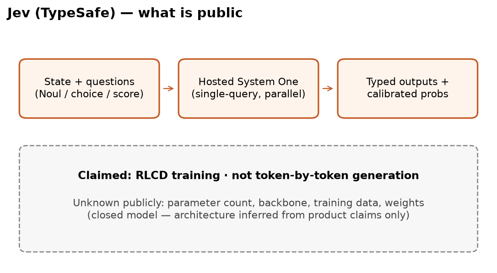

Jev (TypeSafe System One)
==========================

## Introduction

- [**Jev**](https://www.jevtypesafeai.com/) is TypeSafe’s **System One** model — named after [Kahneman’s *Thinking, Fast and Slow*](https://en.wikipedia.org/wiki/Thinking,_Fast_and_Slow): fast, structured decisions instead of open-ended generation.
- You provide a **state** (facts needed for the decision) and a set of **questions**; the API returns **typed, calibrated answers** ready for business logic — not prose to parse.
- Jev runs as a **hosted API** (closed weights). For a local open-weight alternative in the same niche, see [GLiNER2.5-Decide](gliner2_5_decide.md) and the [QQP fine-tuning walkthrough](gliner2_5_decide_qqp_blog.md).

!!! Note
    TypeSafe’s launch post: [Introducing System One models and Jev](https://typesafe.ai/blog/introducing-system-one-models-and-jev).

## Question types

| Type | Role | Typical output |
|------|------|----------------|
| **`choice`** | Pick one of several options | Discrete label |
| **`score`** | Numeric rating on a rubric | Calibrated score |
| **`noul`** | Yes/no as a probability | Class and probability in \([0, 1]\) (threshold at 0.5) |

Instructions for each question are natural-language **criteria**; the model scores against them without generating a chain-of-thought essay.

## Architecture (conceptual)

<figure markdown> 
    
    <figcaption>System One / Jev-style decision flow (state + typed questions → calibrated answers)</figcaption>
</figure>

- Unlike chat LLMs, Jev is built for **decisions over a finite output space** defined per request (choices, scores, or noul probabilities).
- Internals are not public; treat it as an API-first **structured decision service** rather than an inspectable encoder checkpoint.

## Minimal example (duplicate detection)

```python linenums="1"
from typesafe_sdk import Noul, TypeSafeClient

client = TypeSafeClient()

response = client.system_one(
    state={
        "question1": "How do I reset my password?",
        "question2": "What is the process to change my password?",
    },
    questions={
        "is_duplicate": Noul(
            instructions="Do question1 and question2 ask the same thing?",
        ),
    },
)

print(response.answers["is_duplicate"].noul)
# e.g. 0.71 → treat as duplicate if >= 0.5
```

## When to use Jev

- **Strong zero-shot** structured decisions when you are fine with **network latency** and **API billing** (input tokens only on current pricing).
- **No local GPU** or no appetite to fine-tune an open encoder.
- **Privacy** allows sending state to a third-party API.

Compare latency and local deployment tradeoffs in the [GLiNER2.5-Decide QQP blog](gliner2_5_decide_qqp_blog.md).

## References

[1] Jev — [Product site](https://www.jevtypesafeai.com/) | [TypeSafe blog](https://typesafe.ai/blog/introducing-system-one-models-and-jev)

[2] Related local model — [GLiNER2.5-Decide](gliner2_5_decide.md)
